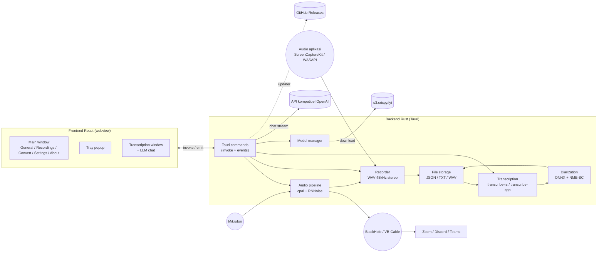

# OVERVIEW — Crispy

> Dokumen ini dibuat dari analisis kode (read-only) pada commit `b3d4c3c` (16 November 2026). Tidak ada kode yang diubah.
> Catatan: tool Context7 tidak tersedia di sesi ini, jadi perintah dan API diambil langsung dari file repo (`Makefile`, `package.json`, workflow CI, `Cargo.toml`) dan dicek silang dengan kode sumbernya.

---

## 1. Aplikasi apa ini?

**Crispy** adalah aplikasi desktop (Tauri v2: backend Rust + frontend React) untuk:

1. **Noise suppression real-time**: suara mikrofon dibersihkan dengan RNNoise, lalu dikirim ke perangkat audio virtual (BlackHole di macOS, VB-Cable di Windows). Aplikasi lain seperti Zoom, Discord, atau Teams memakai perangkat virtual itu sebagai "mikrofon bersih".
2. **Rekam rapat**: merekam mikrofon plus audio aplikasi lain (mis. Chrome atau Zoom) ke file WAV.
3. **Transkripsi offline**: mengubah rekaman jadi teks dengan model AI lokal (Whisper, Parakeet, Moonshine, GigaAM, Canary, Qwen3-ASR, dll.), dengan opsi **diarization** (label "Speaker 1/2/…").
4. **Chat AI tentang transkrip** (opsional): bertanya ke LLM yang kompatibel OpenAI (OpenAI, Poe, dll.) memakai API key milik pengguna.

**Masalah yang diselesaikan:** suara bising saat meeting, dan kebutuhan mencatat/merangkum rapat tanpa mengirim audio ke cloud (privasi).

**Target pengguna:** pekerja remote, podcaster, atau siapa pun yang sering meeting online dan peduli privasi. Platform utama **macOS Apple Silicon**. Windows x64 dan Linux juga di-build, tetapi fiturnya lebih sedikit (lihat bagian 4).

---

## 2. Tech stack

Versi diambil dari `package-lock.json` dan `Cargo.lock` (versi yang benar-benar ter-resolve).

| Lapisan | Teknologi (versi) | Bukti |
|---|---|---|
| Desktop shell | Tauri **2.10.1** (Rust), `@tauri-apps/cli` 2.10.0, `@tauri-apps/api` 2.10.1 | `src-tauri/Cargo.toml`, `package.json` |
| Plugin Tauri | dialog 2.6.0, updater 2.10.0, process 2.3.1, autostart 2.5.1, positioner 2.3.1 | `src-tauri/Cargo.toml` |
| Frontend | React **18.3.1**, TypeScript 5.6.3, Vite 6.4.1 | `package.json` |
| Styling / UI | Tailwind CSS **4.1.18** (via `@tailwindcss/vite`), ikon `lucide-react` 0.563.0, toast `sonner` 2.0.7. Tidak ada UI kit (shadcn/MUI); komponen dibuat sendiri di `src/components/ui/` | `src/App.css`, `src/components/ui/*` |
| Markdown (chat) | react-markdown 10.1.0, remark-gfm 4.0.1, rehype-highlight 7.0.2 (highlight.js 11.11.1, transitif) | `src/components/TranscriptionResultView.tsx` |
| Backend | Rust (edition 2021), Tokio 1.49 | `src-tauri/src/*` |
| Audio | cpal 0.17.1 (I/O), hound 3.5.1 (WAV), rubato 0.16.2 (resampling) | `src-tauri/src/audio.rs`, `recording.rs` |
| Noise suppression | nnnoiseless 0.5.2 (port RNNoise) | `src-tauri/src/audio.rs` |
| Speech-to-text (AI lokal) | transcribe-rs 0.3.11 (ONNX), transcribe-cpp 0.2.3 (GGML/GGUF, Metal di macOS), ort 2.0.0-rc.12 (ONNX Runtime) | `src-tauri/src/managers/transcription.rs`, `transcribe_cpp_engine.rs` |
| Diarization | Model ONNX pyannote segmentation-3.0 + WeSpeaker CAM++, knf-rs 0.3.2, nalgebra 0.33.3 (spectral clustering NME-SC) | `src-tauri/src/managers/diarization.rs` |
| App audio capture | macOS: screencapturekit 1.5.0 (khusus arm64). Windows: WASAPI process loopback (`windows` 0.62.2) | `src-tauri/src/recording.rs`, `windows_audio.rs` |
| LLM / AI service | async-openai 0.28.3 → endpoint kompatibel OpenAI (default `https://api.openai.com/v1`, model `gpt-4`) | `src-tauri/src/commands/transcription.rs` |
| HTTP (download model) | reqwest 0.12.28 | `src-tauri/src/managers/model.rs` |
| Database / ORM | **Tidak ada.** Semua data disimpan sebagai file JSON/TXT/WAV | `src-tauri/src/settings.rs`, `paths.rs` |
| Auth | **Tidak ada** login pengguna. Satu-satunya "kredensial" adalah API key LLM, disimpan plaintext di `settings.json` | `src-tauri/src/settings.rs` |
| Hosting / distribusi | GitHub Releases (installer + `latest.json` untuk auto-update). Model AI di-host di S3 Selectel `https://s3.crispy.fyi/models/` (mirror dari CDN Handy) | `.github/workflows/release.yml`, `src-tauri/tauri.conf.json`, `scripts/sync_models.sh` |
| Testing | Vitest 3.2.4 + jsdom + Testing Library (frontend), `cargo test` (backend) | `vite.config.ts`, `#[cfg(test)]` di file Rust |
| CI/CD | GitHub Actions + `tauri-apps/tauri-action@v0.6.1`, Bun di CI | `.github/workflows/*.yml` |

### Lokasi data di disk

| Data | Lokasi |
|---|---|
| Rekaman | `~/Documents/Crispy/Recordings/*.wav` |
| Transkrip, metadata, riwayat chat | `~/Documents/Crispy/Transcriptions/<hash>.txt` / `.meta` / `.chat.json` |
| Pengaturan (termasuk API key) | `~/Documents/Crispy/settings.json` |
| Model AI | `~/Library/Application Support/com.example.crispy/models/` (macOS) |

### Diagram arsitektur



---
## 3. Cara menjalankan (langkah demi langkah)

### 3.1 Prasyarat

| Kebutuhan | Keterangan |
|---|---|
| OS | **macOS 13+ di Apple Silicon** (fitur paling lengkap). Windows 10 2004+ x64 dan Ubuntu 24.04+ (glibc ≥ 2.38) juga bisa |
| Node.js | 18+ (README). CI memakai Bun; secara lokal cukup `npm` |
| Rust | stable terbaru via [rustup](https://rustup.rs) |
| macOS | Xcode Command Line Tools (`xcode-select --install`) dan **CMake** (`brew install cmake`). CMake dibutuhkan untuk meng-compile ggml milik transcribe-cpp; CI Linux menginstalnya secara eksplisit |
| Linux | `libwebkit2gtk-4.1-dev libgtk-3-dev libayatana-appindicator3-dev librsvg2-dev libasound2-dev cmake` (lihat `.github/workflows/lint.yml`) |
| Windows | Visual Studio Build Tools (MSVC) dan Vulkan SDK (CI memakai 1.4.309.0) |
| Opsional | **BlackHole 2ch** (macOS) / VB-Cable (Windows) untuk merutekan audio bersih; **ffmpeg** di PATH untuk fitur Convert |

### 3.2 Instalasi dan menjalankan mode dev

```bash
git clone https://github.com/sleep3r/crispy.git
cd crispy

# 1. Pasang dependensi Node (dan cek Rust)
make install            # = npm install + cek rustc

# 2. Jalankan mode development (Vite di port 1420 + jendela Tauri)
make dev                # = npm run tauri dev
# Log Rust lebih detail:
RUST_LOG=debug make dev
# Log audio internal:
CRISPY_AUDIO_DEBUG=1 make dev
```

Kompilasi pertama lama (beberapa menit) karena ggml/whisper dan ONNX Runtime ikut dibangun atau diunduh.

### 3.3 Environment variable

Aplikasi **tidak membutuhkan file `.env`** untuk berjalan. API key LLM diisi lewat UI (Settings → LLM Chat).

| Variabel | Untuk apa | Di mana |
|---|---|---|
| `TRANSCRIBE_CMAKE_ARGS=-DGGML_NATIVE=OFF` | Sudah otomatis diset; mencegah build gagal di Apple clang | `.cargo/config.toml` |
| `MACOSX_DEPLOYMENT_TARGET=13.0` | Sudah otomatis diset | `src-tauri/.cargo/config.toml` |
| `TAURI_DEV_HOST` | Opsional, untuk dev di jaringan/perangkat lain | `vite.config.ts` |
| `S3_ACCESS_KEY_ID`, `S3_SECRET_ACCESS_KEY`, `S3_REGION`, `S3_BUCKET`, `S3_ENDPOINT` | **Hanya untuk maintainer**: mirror model ke S3 lewat `scripts/sync_models.sh` (file `.env` di root, sudah di-gitignore) | `scripts/sync_models.sh` |
| Secret CI: `TAURI_SIGNING_PRIVATE_KEY`, `TAURI_SIGNING_PRIVATE_KEY_PASSWORD`, `APPLE_CERTIFICATE`, `APPLE_CERTIFICATE_PASSWORD`, `KEYCHAIN_PASSWORD`, `APPLE_ID`, `APPLE_PASSWORD`, `APPLE_TEAM_ID` | Untuk rilis bertanda tangan dan auto-update | `.github/workflows/build.yml` |

### 3.4 Setup pertama di dalam aplikasi

1. Izinkan akses **Microphone** dan **Screen Recording** (macOS). Screen Recording dipakai untuk menangkap audio aplikasi.
2. General → pilih mikrofon dan output **BlackHole 2ch**.
3. Pilih model noise suppression di footer: **RNN Noise**. Lihat bug P0-1 di bagian 5: setelah pilihan pertama kali diubah dari "None", **restart aplikasi**.
4. Recordings → footer → unduh dan pilih model transkripsi (rekomendasi: Parakeet V3).
5. (Opsional) Settings → Transcription → aktifkan diarization (mengunduh model ±34 MB).
6. (Opsional) Settings → LLM Chat → isi endpoint, API key, dan model.

### 3.5 Test, cek, dan build

```bash
npm test                 # Vitest (frontend)
make test-backend        # cargo test (backend)
npm run lint             # sebenarnya hanya `tsc --noEmit`; ESLint belum dikonfigurasi
make check               # tsc + cargo check

# Build produksi lokal (lihat bug P1-4 soal path codesign):
npx tauri build --target aarch64-apple-darwin
codesign --sign - --force --deep target/aarch64-apple-darwin/release/bundle/macos/Crispy.app
```

Hasil build ada di `target/<triple>/release/bundle/` di **root repo**, bukan `src-tauri/target`, karena repo ini adalah Cargo workspace.

### 3.6 Rilis (maintainer)

1. `make version-bump TYPE=patch` menaikkan versi di 3 file.
2. Jalankan workflow **Release** secara manual (`workflow_dispatch`). Workflow membuat **draft** release dan mem-build macOS arm64, Linux x64/arm64, dan Windows x64.
3. **Publish draft secara manual** di GitHub. Selama masih draft, auto-updater tidak akan melihat versi baru.

---

## 4. Status pekerjaan: PRD vs kode

> **`PRD.md` tidak ada di repo** (dicek dengan `find` dan `git ls-files`). Sebagai gantinya, daftar fitur yang dijanjikan di **`README.md`** dipakai sebagai acuan, ditambah fitur yang ada di kode tetapi tidak disebut di README.

| Fitur / pekerjaan | Status | Bukti (path) | Catatan |
|---|---|---|---|
| Noise suppression RNNoise 48 kHz | Selesai | `src-tauri/src/audio.rs` (`RnnNoiseProcessor`) | Berfungsi, tetapi lihat bug P0-1 saat ganti model |
| Mode "None" (passthrough) | Sebagian | `src-tauri/src/audio.rs` (`start_monitoring`, `shared = None`) | Dengan model `dummy`, **output stream tidak dibuat**, jadi tidak ada audio yang sampai ke BlackHole |
| Mode "Test noise" | Selesai | `src-tauri/src/audio.rs` (`SharedAudio`, `noisy`) | Mode debug |
| Adaptive volume control | Sebagian | `src/components/settings/MicrophoneVolume.tsx`, `src-tauri/src/system_input_volume.rs` | Hanya slider volume manual / volume input sistem (macOS); tidak ada AGC otomatis |
| Zero-latency monitoring | Tidak terverifikasi | `src-tauri/src/audio.rs` | Tidak ada pengukuran latensi; RNNoise memproses per frame 480 sampel (10 ms) |
| Routing ke aplikasi lain (BlackHole) | Selesai | `src-tauri/src/audio.rs` (`get_default_devices`, `get_blackhole_status`) | Banner panduan untuk macOS/Windows/Linux di `GeneralSettings.tsx` |
| Rekam mikrofon ke WAV | Selesai | `src-tauri/src/recording.rs`, `commands/recording.rs` | 48 kHz, stereo dual-mono, 16-bit |
| Rekam audio aplikasi (dual-source) | Sebagian | `src-tauri/src/recording.rs`, `src-tauri/src/windows_audio.rs` | Hanya macOS **arm64** dan Windows 10 2004+. Linux dan Mac Intel: mikrofon saja |
| Auto-resampling 44.1→48 kHz | Selesai | `src-tauri/src/recording.rs` (`resample_audio`), `audio.rs` (`LinearResampler`) | Resampler linear (kualitas sedang) |
| Rekam satu klik dari tray | Selesai | `src/components/TrayPopupView.tsx`, `src-tauri/src/window.rs` | |
| Transkripsi **otomatis** setelah rekaman selesai | Belum | `src/components/settings/recordings/RecordingsHistory.tsx` (tombol `onTranscribe`) | README menjanjikan otomatis, tetapi kode hanya punya tombol "Transcribe" manual |
| Download/kelola model transkripsi | Selesai | `src-tauri/src/managers/model.rs`, `src/hooks/useTranscriptionModels.ts` | ±22 model, resumable download; **tanpa verifikasi checksum** |
| Engine transkripsi (ONNX + GGML/GGUF) | Selesai | `src-tauri/src/managers/transcription.rs`, `transcribe_cpp_engine.rs` | Chunk 30 s; hanya kanal kiri (ch 0) yang ditranskripsi |
| Metadata model per transkrip | Selesai | `src-tauri/src/managers/transcription.rs` (`.meta`) | |
| Diarization (label pembicara) | Selesai | `src-tauri/src/managers/diarization.rs`, `src/components/settings/DiarizationToggle.tsx` | Tidak disebut di README. Parameter `threshold` diterima tetapi tidak dipakai |
| Chat AI tentang transkrip (streaming) | Selesai | `src-tauri/src/commands/transcription.rs` (`do_stream_chat`), `src/components/TranscriptionResultView.tsx` | Render Markdown; transkrip panjang dikirim utuh (bisa melebihi batas token). Tidak ada tombol stop |
| Riwayat chat per rekaman | Selesai | `commands/transcription.rs` (`set_transcription_chat_history`) | |
| Konfigurasi LLM | Sebagian | `src/components/settings/LlmConfig.tsx`, `src-tauri/src/commands/settings.rs` | Bug: menyimpan tanpa mengetik ulang key akan **menghapus API key** (P0-2) |
| Penyimpanan lokal (offline) | Selesai | `src-tauri/src/paths.rs`, `settings.rs` | Penulisan atomic + migrasi file lama |
| "100% offline" | Sebagian | `index.html` (Google Fonts), `managers/model.rs` (S3), updater | Font diambil dari Google; model harus diunduh dulu |
| Tray popup | Selesai | `src-tauri/src/window.rs`, `src/components/TrayPopupView.tsx` | |
| Dark mode | Selesai | `src/App.css`, `index.html` | Mengikuti `prefers-color-scheme` |
| Settings persisten | Selesai | `src-tauri/src/settings.rs` | Semua nilai disimpan sebagai string |
| Onboarding izin (mic, screen recording) | Selesai (macOS) | `src-tauri/src/commands/permissions.rs`, `src/components/PermissionsOnboarding.tsx` | OS lain selalu dianggap "granted" |
| Riwayat rekaman (play, rename, delete) | Selesai | `src/components/settings/recordings/RecordingsHistory.tsx`, `src/components/ui/AudioPlayer.tsx` | Delete tidak menghapus file `.txt`/`.meta`/`.chat.json` |
| Convert media → WAV | Selesai | `src-tauri/src/commands/convert.rs`, `src/components/convert/ConvertView.tsx` | Butuh ffmpeg terpasang manual (tidak dibundel) |
| Autostart | Selesai | `src-tauri/src/commands/settings.rs` (`set_autostart`) | |
| Auto-update | Sebagian | `src-tauri/tauri.conf.json` (updater), `src/components/footer/UpdateChecker.tsx` | Release masih draft (harus publish manual); identifier masih `com.example.crispy` |
| CI: lint, test, build multi-OS | Sebagian | `.github/workflows/*.yml` | Lint hanya `tsc`; test hanya jalan di PR dan hanya di Linux; tidak ada clippy/fmt |
| Code signing / notarization macOS | Sebagian | `.github/workflows/build.yml` | Butuh secret Apple; Windows belum ditandatangani |
| Unit test | Sebagian | `src/lib/utils/*.test.ts`, `#[cfg(test)]` di `main.rs`, `audio.rs`, `recording.rs`, `settings.rs`, `diarization.rs` | Tidak ada test komponen React, download model, chat, atau pipeline audio |
| Dokumentasi `INSTALL.md` | Belum | `README.md` baris 155 | Link ke file yang tidak ada |
| `PRD.md` | Belum | — | Tidak ada dokumen requirement formal |

---
## 5. Prioritas berikutnya menuju produksi

Urutan disusun dari yang paling cepat dikerjakan dan paling besar dampaknya ke pengguna.

### P0: Bug yang langsung terasa pengguna (perbaikan kecil)

1. **Ganti model noise dari "None" ke "RNN Noise" tidak berfungsi sampai aplikasi di-restart.**
   - Model default adalah `dummy`, sehingga `shared = None`.
   - `MicrophoneVolume.tsx` lalu memanggil `set_monitoring_model`, yang gagal dengan error "Monitoring not started" (`audio.rs`, `set_monitoring_model`). Error ini hanya muncul di console.
   - `start_monitoring` juga langsung return kalau device-nya sama.
   - Perbaikan: selalu buat `NsState` (passthrough untuk `dummy`), atau panggil `stop_monitoring` + `start_monitoring` saat model berubah.
2. **API key LLM terhapus saat menekan Save tanpa mengetik ulang key.** `LlmConfig.tsx` mengirim `apiKey: ""`, lalu `set_llm_settings` (`commands/settings.rs`) menimpa key lama. Perbaikan: abaikan key kosong di backend.
3. **Mode "None" tidak meneruskan audio ke BlackHole** (output stream tidak dibuat). Ini ikut terselesaikan oleh perbaikan no. 1.
4. **Potensi panic/alokasi raksasa di protokol `stream://`.** `parse_range` (`main.rs`) menerima `bytes=500-100` dan `bytes=-0`, sehingga `range.1 - range.0 + 1` underflow. Perbaikan: tolak range dengan `start > end` atau suffix 0.

### P1: Konfigurasi yang hilang atau salah (wajib sebelum rilis publik)

1. **Bundle identifier masih `com.example.crispy`** (`tauri.conf.json`) dan `authors = ["you"]` (`src-tauri/Cargo.toml`). Mengganti identifier setelah rilis akan memindahkan folder data model pengguna, jadi lakukan sekarang.
2. **Keamanan webview terlalu longgar:**
   - `"csp": null`.
   - `assetProtocol.scope.allow: ["**"]`: webview bisa membaca file apa pun.
   - `stream://` melayani path absolut apa pun tanpa cek scope.
   - Perbaikan: batasi ke folder `~/Documents/Crispy/**` dan set CSP.
3. **API key disimpan plaintext** di `~/Documents/Crispy/settings.json`. Folder Documents sering tersinkron ke iCloud. Pindahkan key ke Keychain/Credential Manager (mis. crate `keyring`).
4. **`make build` salah path.** Perintah build dijalankan tanpa `--target`, tetapi `codesign` menunjuk ke `target/aarch64-apple-darwin/...`. `make clean` juga menghapus `src-tauri/target`, padahal output ada di `./target`.
5. **Release masih draft.** `latest.json` untuk updater baru bisa diakses setelah draft dipublish manual. Pertimbangkan publish otomatis setelah semua job sukses.
6. **Release tidak bergantung pada lint/test.** Workflow `lint.yml` hanya jalan di `pull_request`. Tambahkan trigger `push` ke main, dan jadikan test sebagai syarat release.
7. **AppImage Linux:** langkah penghapusan `libwayland-client.so` (`build.yml`) berjalan *setelah* upload ke release, jadi file di release tidak ikut diperbaiki. Kalaupun di-upload ulang, signature updater (`.sig`) tidak cocok lagi.
8. **Runner macOS berbeda:** release memakai `macos-14`, sedangkan test-build memakai `macos-26`. Samakan supaya yang dirilis sama dengan yang diuji.
9. **Dokumen dan referensi yang hilang:**
   - `INSTALL.md` dirujuk di README tetapi tidak ada.
   - Target `make check-no-whisper-rs` disebut di `src-tauri/Cargo.toml` tetapi tidak ada di Makefile (pengamannya hanya job CI `no-duplicate-ggml`).
   - Komentar `./rnnnoise` dan "pyannote-rs" sudah usang.
10. **Google Fonts** di `index.html` bertentangan dengan klaim "completely offline". Bundel font Outfit secara lokal.

### P2: Kualitas dan ketahanan

1. **Verifikasi integritas model.** Checksum sha256 sudah ada di `scripts/sync_models.sh` tetapi tidak dipakai di `managers/model.rs`. Tambahkan cek sha256 setelah download.
2. **Transkripsi otomatis setelah stop recording** (dijanjikan README) belum ada. Cukup panggil `start_transcription` setelah `stop_recording` jika model sudah dipilih.
3. **Mixing mic + app tanpa headroom** (`commands/recording.rs`) membuat audio clipping saat keduanya keras. Beri gain 0.5 atau limiter.
4. **Hapus rekaman meninggalkan file yatim** `.txt`/`.meta`/`.chat.json` (`delete_recording`).
5. **Nama file transkrip memakai `DefaultHasher`** (`managers/transcription.rs`). Hash ini tidak dijamin stabil antar versi Rust, sehingga transkrip bisa "hilang" setelah upgrade toolchain. Ganti ke hash stabil (mis. SHA-256 dari path).
6. **Transkripsi hanya membaca kanal 0**, jadi untuk file stereo hasil Convert, kanal kanan diabaikan. Downmix dulu ke mono.
7. **Lock `Mutex` + `.unwrap()` di callback audio real-time** (`audio.rs`): mutex yang poisoned akan membuat thread audio panic. Dengan `panic = "abort"`, seluruh aplikasi crash. Gunakan `try_lock` atau ring buffer lock-free.
8. **Dua transkripsi paralel dengan model berbeda** bisa saling mengganggu (`load_model` mengosongkan engine). Tambahkan antrean.
9. **`open_url` di Windows** memakai `cmd /C start`, sehingga rawan injeksi karakter khusus. Validasi skema `https://` atau pakai plugin `opener`.
10. **Frontend:**
    - Pesan error dari backend (berupa string) tertutup oleh pengecekan `err instanceof Error`.
    - `alert()` dan banyak `console.log` masih dipakai.
    - Komponen mati: `ModelSelector.tsx`, `NoiseModelSelector.tsx`, `TranscriptionModelSelector.tsx`.
    - `tailwind.config.js` tidak terpakai (Tailwind v4 memakai `@theme` di `App.css`).
    - `highlight.js` di-import tetapi tidak dideklarasikan di `package.json`.
    - Ada tombol yang bersarang di dalam tombol di `FooterModelSelector.tsx`.
11. **Tooling:**
    - Tambahkan ESLint, `cargo clippy`, dan `cargo fmt --check` ke CI.
    - Toolchain campur: CI memakai Bun tanpa lockfile Bun, sedangkan lokal memakai npm dengan `package-lock.json`.
    - Versi Bun belum di-pin.
12. **Lainnya:**
    - `pr-test-build.yml` mem-build kode PR dengan `secrets: inherit` (termasuk private key updater). Ini risiko keamanan, meskipun hanya maintainer yang bisa memicunya.
    - Fallback `cargo install tauri-cli` di `generate_updater_key.sh` tidak menghasilkan binary `tauri`.

### Ringkasan prioritas

| # | Pekerjaan | Usaha | Dampak |
|---|---|---|---|
| 1 | Perbaiki switch model noise + passthrough "None" | Kecil | Tinggi |
| 2 | Jangan timpa API key kosong | Sangat kecil | Tinggi |
| 3 | Validasi `parse_range` | Sangat kecil | Sedang (stabilitas) |
| 4 | Ganti bundle identifier dan authors | Sangat kecil | Tinggi (sebelum rilis) |
| 5 | Persempit asset scope + scope `stream://` + CSP | Kecil | Tinggi (keamanan) |
| 6 | API key ke Keychain | Sedang | Tinggi (keamanan) |
| 7 | Perbaiki Makefile build/clean dan publish release | Kecil | Sedang |
| 8 | Checksum model, auto-transcribe, headroom mixing | Sedang | Sedang |
| 9 | CI: test di push, clippy, ESLint | Kecil | Sedang |

---

## Catatan verifikasi

- Analisis dilakukan dengan membaca seluruh file yang di-track git (frontend, backend Rust, workflow CI, script, konfigurasi).
- **Test dan build tidak dijalankan:** `node_modules` belum terpasang dan Rust/Cargo tidak tersedia di mesin ini. Menjalankannya berarti mengubah workspace, padahal permintaannya analisis tanpa perubahan.
- Bug P0-1, P0-2, dan P0-4 dikonfirmasi dengan membaca kode secara langsung, tetapi belum direproduksi saat runtime.
